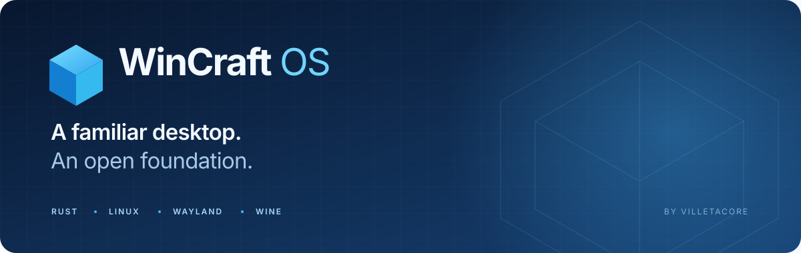
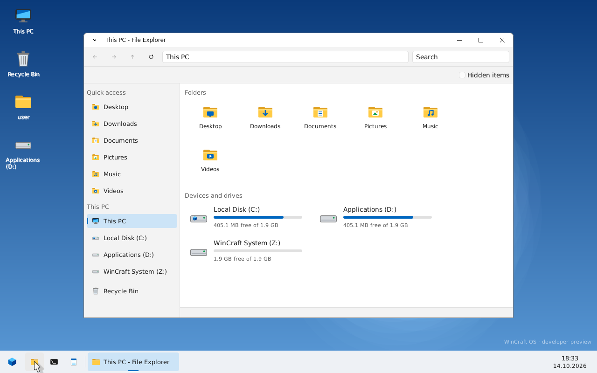
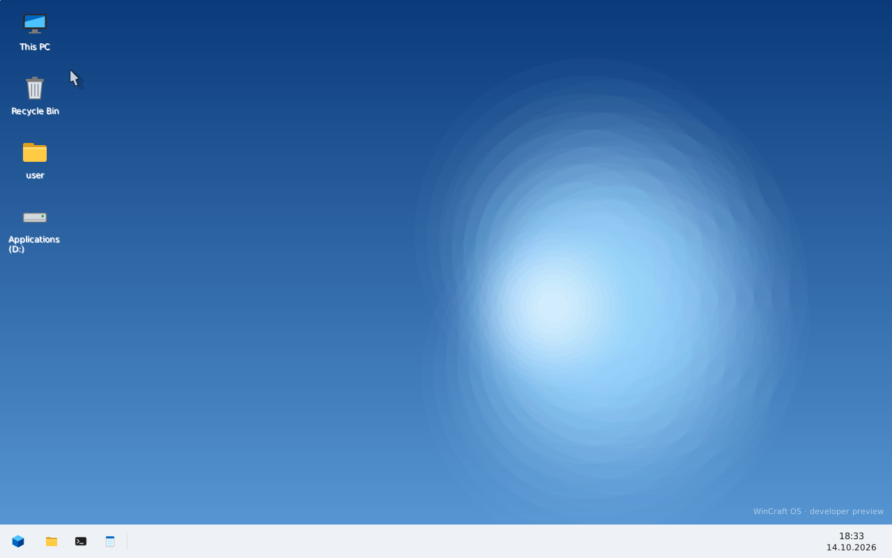
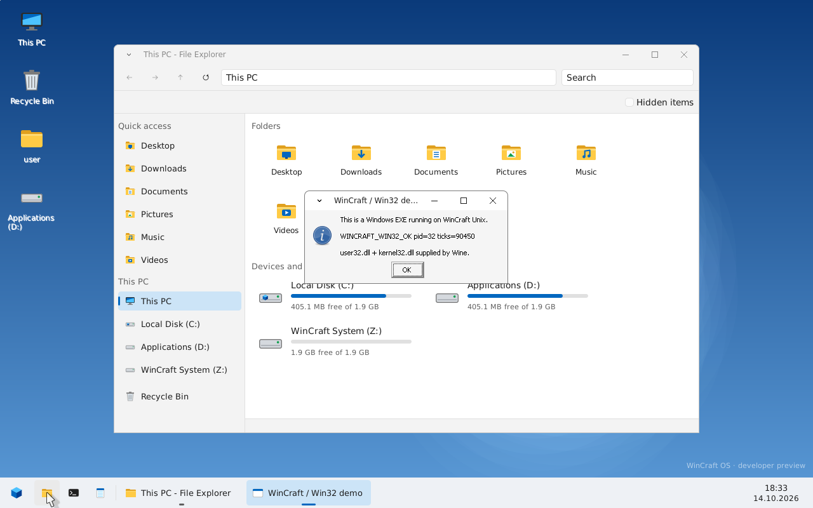
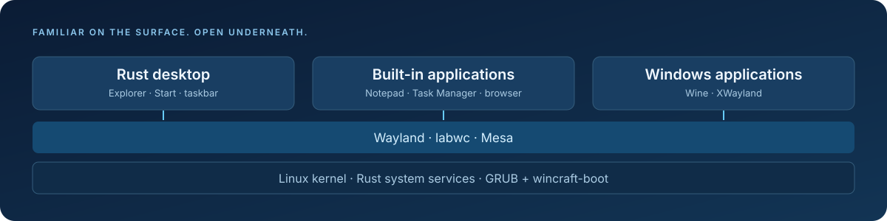

<div align="center">



**Экспериментальная система на Linux: оболочка на Rust, привычные пути и Windows-программы через Wine.**

[](https://github.com/villetacore/wincraft/actions/workflows/ci.yml)
[](https://github.com/villetacore/wincraft/releases)
[](LICENSE)
[](#статус)

[Релизы](https://github.com/villetacore/wincraft/releases) · [Документация](docs/README.md) · [Архитектура](docs/12-wincraft-os.md) · [Участие](CONTRIBUTING.md) · [English](README.md)

</div>

---

WinCraft соединяет знакомый настольный интерфейс с открытой Unix-системой. В основе — ванильное ядро Linux, собственная оболочка на Rust, Wayland и Wine. Текущая платформа — **виртуальные машины QEMU x86-64**.

<p align="center">
<a href="docs/screenshots/explorer.png"></a>
<br><sub><b>Файлы на привычных местах.</b> Проводник на рабочем столе WinCraft.</sub>
</p>

<table>
<tr>
<td width="50%"><a href="docs/screenshots/desktop.png"></a></td>
<td width="50%"><a href="docs/screenshots/win32-demo.png"></a></td>
</tr>
<tr>
<td align="center"><b>Рабочий стол</b><br>Собственная оболочка и панель задач</td>
<td align="center"><b>Windows внутри Unix</b><br>Настоящая Win32-программа через Wine</td>
</tr>
</table>

<sub>Настоящие снимки локального live-образа в QEMU от 14 октября 2026 года. Они показывают прототип, а не подтверждённую сборку из GitHub Releases.</sub>

## Возможности

| Привычный интерфейс | Открытая основа |
| --- | --- |
| Рабочий стол, «Пуск», Проводник и панель задач | Linux, Wayland, labwc, XWayland и Mesa |
| Диски `C:\`, `D:\`, известные папки пользователя | Собственные компоненты на Rust |
| Запуск Windows-программ через Wine | Пакет WoW64 с поддержкой x64 и x86 |
| Блокнот, Диспетчер задач, браузер на WebKitGTK | Live ISO для BIOS и UEFI |
| Параметры, Корзина и диалог «Выполнить» | Система только для чтения, изменения в RAM |

## Попробовать

Скачайте ISO, `wincraft-launcher.zip` и `SHA256SUMS` из одного [релиза](https://github.com/villetacore/wincraft/releases). Если релизов ещё нет, первая проверенная сборка пока не опубликована.

**Windows:** установите QEMU, распакуйте лаунчер, поместите ISO в его папку `dist` под именем `wincraft-os.iso` и запустите `WinCraft.cmd`.

```powershell
# 4 ГБ RAM и два виртуальных процессора
.\scripts\run-iso.ps1 -Memory 4096 -Cpus 2

# BIOS и программная эмуляция
.\scripts\run-iso.ps1 -Bios -NoData -Accel tcg

# Сравните результат со строкой ISO в SHA256SUMS
Get-FileHash .\dist\wincraft-os.iso -Algorithm SHA256
```

**Linux:** установите QEMU и укажите настоящее имя скачанного ISO:

```sh
sha256sum -c SHA256SUMS --ignore-missing
qemu-system-x86_64 -machine q35 -accel tcg -cpu Nehalem \
  -m 4096 -smp 2 -vga std -boot d -cdrom wincraft-os-v0.4.0-x86_64.iso
```

Имя ISO выше приведено как пример; preview-теги добавляют суффикс. Без диска `WINCRAFT_DATA` изменения исчезают после выключения. Подробнее: [сборка, проверки и диск данных](docs/BUILDING.md).

## Горячие клавиши

| Клавиши | Действие |
| --- | --- |
| Win | «Пуск» |
| Win+E / Win+R | Проводник / «Выполнить» |
| Win+D / Alt+Tab | Рабочий стол / переключение окон |
| Alt+F4 / Win+← / Win+→ | Закрыть / прикрепить окно |
| Ctrl+Shift+Esc | Диспетчер задач |

## Архитектура



GRUB загружает Linux и `wincraft-boot`. Затем `wincraft-init` запускает службы, `winlogon` готовит пользовательский сеанс, а labwc управляет окнами Wayland и XWayland. Explorer отвечает за рабочий стол и файловый интерфейс, Wine — за Windows-программы.

[Подробная архитектура](docs/12-wincraft-os.md) · [Принятые решения](docs/10-decisions.md) · [Дорожная карта](docs/06-roadmap.md)

## Разработка

Быстрые проверки библиотек работают на Windows, Linux и macOS:

```sh
git clone https://github.com/villetacore/wincraft.git
cd wincraft
cargo test --locked
```

Полная сборка требует Linux x86-64 или Ubuntu в WSL, прав root для изолированного builder, сети и большого объёма свободного диска. Первая сборка Linux, LLVM, WebKitGTK и Wine может занять много часов.

```sh
sudo bash build/builder.sh setup
sudo bash build/builder.sh run bash build/release.sh
```

CI проверяет библиотеки на Windows/Linux и гостевой workspace на Linux. Изменения кода и сборки в `main` также запускают сборку ISO и проверки загрузки BIOS/UEFI. Готовый образ доступен семь дней в **Actions → Release → Artifacts → wincraft-iso-…**. Тег `v*` публикует prerelease с ISO, исходниками, лицензиями и SHA-256. Сборку можно запустить вручную: **Actions → Release → Run workflow**.

[Инструкция сборки](docs/BUILDING.md) · [Подготовка релиза](docs/RELEASING.md) · [Как участвовать](CONTRIBUTING.md) · [Изменения](CHANGELOG.md)

## Статус

**0.4.0 · Developer preview.** Установщик, автоматические обновления и экран входа пока не реализованы. Совместимость с конкретными Windows-программами зависит от приложения; поддержка Windows-драйверов и античитов не заявляется. Используйте одноразовую VM и резервные копии. Debug-пункт загрузки открывает root shell на последовательном порту; обычная загрузка — нет.

## Лицензия

Собственный код WinCraft — [MIT](LICENSE). Проект поддерживает **villetacore**. Сторонние компоненты сохраняют свои лицензии; лицензия MIT не распространяется автоматически на весь ISO. См. [сторонние компоненты](THIRD_PARTY.md) и [политику безопасности](SECURITY.md).

Спасибо сообществам Linux, Rust, Buildroot, Wine, labwc, wlroots, Wayland, Mesa, GTK, WebKitGTK и DejaVu. WinCraft — независимый проект, не связанный с Microsoft и ReactOS. Windows — товарный знак Microsoft.
