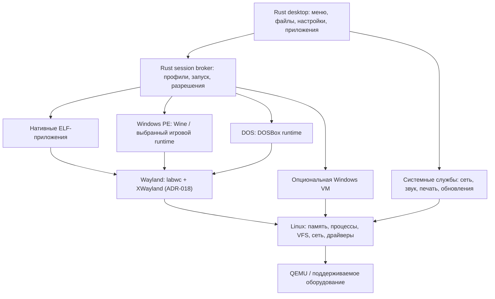

# Целевая архитектура

Статус: предлагаемый дизайн. Имена `wincraft-*` ниже обозначают будущие компоненты, если явно не указано обратное.

## 1. Слои системы



Нативный ELF не означает совместимость со всеми Linux-дистрибутивами: нужны совпадающие CPU, libc, динамический загрузчик и библиотеки. Windows API обслуживает runtime, не Rust-launcher. Драйверы физических устройств в основной ветке — Linux-драйверы.

## 2. Базовая система и libc

Alpine/musl сохраняется для воспроизводимого baseline. До замораживания desktop runtime проводится отдельный эксперимент с glibc-базой или герметичным glibc runtime. Для широкого набора Linux desktop/игровых компонентов **предпочтительная гипотеза — glibc**, но смена базы принимается только по результатам одинаковых тестов.

Сравнить: Wine x64/x86, зависимости графики, запуск нативного браузера, аудио, доступность отладочных символов, объём security updates, размер образа и стоимость собственной упаковки. Не подкладывать glibc-библиотеки в musl-систему случайными копированиями. Если выбран отдельный runtime, он должен иметь собственный loader, согласованные библиотеки, manifest и механизм обновления. Переход базы не должен менять формат пользовательских документов.

## 3. Init и системные службы

Существующий `wincraft-init` развивается в небольшой supervisor. Не пытаться воспроизвести все функции зрелой init-системы сразу. Если собственное сопровождение мешает надёжности, допустим mature supervisor под Rust-менеджером с отдельным ADR.

Загрузка: mount виртуальных FS → обнаружение устройств → системный root → writable state → службы → login/session → desktop. Критические сбои переводят в recovery, необязательные службы помечаются degraded.

Контракт service unit:

- argv без shell-интерполяции, рабочий каталог и ограниченный environment;
- UID/GID, группы, capabilities, лимиты ресурсов;
- зависимости и явная готовность, timeout запуска/остановки;
- политика restart с backoff и предельным количеством сбоев;
- stdout/stderr в структурированный журнал, exit status и причина остановки.

PID 1 обязан собирать завершённые процессы, обрабатывать сигналы, завершать дерево служб и обеспечивать recovery. GUI не должен вызывать произвольные root-команды.

Сеть, DHCP/DNS, синхронизация времени, udev, звук и печать сначала интегрируются из сопровождаемых upstream-компонентов. Rust UI обращается к их API через адаптеры. Новый network stack для Linux-ветки не нужен.

## 4. Граница user/system

| Процесс | Права | Ответственность |
| --- | --- | --- |
| Init/supervisor | Системные | Mount, запуск/остановка служб |
| Login/session manager | Минимально необходимые | Создание пользовательской сессии |
| Desktop | Обычный пользователь | UI, запуск пользовательских запросов |
| Runtime broker | Владелец сессии | Профили, процессы, окружение, журналы |
| Install/update helper | Привилегированный, узкий API | Только валидированные операции с системой |
| Windows/DOS/ELF apps | Пользователь + ограничения | Работа с разрешёнными ресурсами |

Unix socket с проверкой peer credentials — базовый транспорт собственного локального IPC. Для существующих служб использовать их D-Bus/API. Сообщения имеют version, request_id, операцию, аргументы и структурированный результат. Ограничить размеры, время ожидания, число запросов. Никогда не принимать команду shell как административный API.

Запрос на установку содержит идентификатор заранее проверенного плана; helper повторно сверяет устройства и состояние. Одна проверка в GUI не защищает от подмены между просмотром и исполнением. Отмена и повтор запроса должны иметь определённую семантику.

## 5. Менеджер приложений

Единая точка запуска обслуживает menu, file associations, Run, CLI и installers.

Последовательность: определить формат → выбрать профиль → проверить runtime → подготовить prefix → получить разрешения → запустить → наблюдать весь job → сохранить результат. Неизвестный формат не исполняется автоматически. MZ может означать DOS, NE или PE; `.exe` само по себе недостаточно.

Для PE проверить границы заголовков, Machine, Optional Header, тип EXE/DLL, subsystem и размеры с защитой от переполнений. Это классификатор, не собственный загрузчик PE. Полную загрузку, relocations, imports и Windows execution semantics делегировать runtime.

Пример **проектного** профиля, не поддерживаемого текущим кодом:

```toml
schema_version = 1
app_id = "example.editor"
runtime_id = "wine-desktop-pinned-build"
format = "pe"
architecture = "x86_64"
executable = "drive_c/Program Files/Example/editor.exe"
arguments = []
working_directory = "drive_c/users/user/Documents"
network = "ask"
graphics = "default"
shared_folders = []
```

Runtime-id разрешается через manifest с точным build/hash, а не строкой `latest`. Аргументы — массив; Windows quoting поручается проверенному backend. Профиль содержит происхождение, зависимости, проверенные сценарии, разрешения, migration version и минимальную версию ОС.

Installer и приложение не обязаны быть одним PID. Broker отслеживает job/process group и дочерние процессы; закрытие установщика не всегда означает завершение установки. Wine server может обслуживать несколько процессов одного prefix: остановка одного приложения не должна случайно завершать другое. По умолчанию отдельный prefix на приложение; группы приложений с COM-интеграцией объединяются явно.

## 6. Данные и файловая семантика

Проектная раскладка:

| Путь | Назначение |
| --- | --- |
| `/usr` | Версионированная системная поставка |
| `/etc` | Конфигурация с контролируемой миграцией |
| `/var/lib/wincraft` | Метаданные установки/обновлений |
| `/var/lib/wincraft/runtimes` | Проверенные неизменяемые runtime |
| `/home/<user>` | Личные документы и настройки |
| `~/.local/share/wincraft/apps/<id>` | Профиль, prefix, состояние приложения |
| `~/.local/state/wincraft` | Журналы и результаты запусков |
| `/run/wincraft` | Временные сокеты и сведения текущей загрузки |

Не делать системный `/` глобальным диском C:. Предоставлять Windows-приложению C: внутри prefix и явно выбранные папки обмена. Wine drive mappings и доступ к Unix-путям ограничиваются вместе с mount namespace; удаление одной буквы диска не является sandbox.

Тестировать регистр имён, Unicode, длинные пути, имена устройств Windows, share modes, file locking, rename открытого файла, symlinks/reparse points, timestamps, ADS и notifications. Unix UID/GID и Windows SID/ACL не эквивалентны. В первой версии доступ ограничивает Unix-пользователь и sandbox, а Windows ACL внутри runtime имеют документированные ограничения. Не обещать полное сохранение NTFS security descriptors при копировании.

Файловая система root/data сначала ext4; read-only image для live root. NTFS — дополнительный формат обмена после проверки драйвера и сценариев отказа. Hibernated/нечистый Windows volume не монтируется на запись автоматически. Дисковые операции выполняются только через storage service.

## 7. Desktop и графика

По ADR-018 дисплейный сервер — Wayland на существующем композиторе (labwc/wlroots), Xorg удалён. Композитор работает от имени пользователя, устройства выдаёт seatd. Оболочка — хороший клиент существующей графической системы: layer-shell для рабочего стола и панели задач, wlr-foreign-toplevel для списка окон. Windows-программы идут через XWayland; между X11-клиентами остаются ограничения изоляции, для недоверенных приложений нужен отдельный display context или VM.

Ещё не проверено и остаётся в DESK-02/WAY-01: clipboard и drag-and-drop между Wayland и XWayland, IME, DPI, fullscreen игр, несколько мониторов, accessibility, screen capture, `winewayland.drv`. Собственный композитор на Rust — последующий проект.

GPU chain: приложение → WineD3D или DXVK/vkd3d-proton → OpenGL/Vulkan → Mesa/подходящий Linux-драйвер → GPU. DXVK реализует Direct3D поверх Vulkan, vkd3d-proton — Direct3D 12; требования зависят от закреплённой версии. См. [DXVK](https://github.com/doitsujin/dxvk), [vkd3d-proton](https://github.com/HansKristian-Work/vkd3d-proton).

Software rendering остаётся recovery-mode. Результат на QEMU std VGA не подтверждает аппаратный Vulkan. Для аппаратной сертификации нужен отдельный стенд с GPU и драйвером из manifest.

## 8. Системная интеграция

Нужны звук с выбором устройств, микрофон с разрешениями, раскладки RU/EN и IME, сеть и Wi-Fi, Bluetooth, питание/батарея, suspend/resume, printing, USB media, время/локаль и доступность. Каждый пункт имеет UI, backend, ошибки и тесты восстановления. Ярлык «Settings» без работающего backend не считается функцией.

Credentials хранить в пользовательском защищённом хранилище; не в app profile или журнале. Телеметрия по умолчанию отсутствует; отчёт об ошибке пользователь просматривает перед отправкой. Offline-диагностика должна работать без сервера проекта.

## Уточнение реализации после анализа 0.3

Основной путь Linux → собственное окружение Rust → управляемый Wine принят 14.10.2026. Следующие контракты уточняют план и ещё не реализованы:

1. Runtime имеет состояния preparing/ready/failed, причину ошибки, timeout и отмену. Наличие system.reg или создание процесса-ожидателя не доказывает готовность. Сначала исправляется текущий общий prefix (FIX-01), затем вводятся per-app profiles.
2. Менеджер приложений ведёт профиль, argv/cwd, точный runtime, job и журнал. Установка создаёт ярлык; удаление не затрагивает соседние окружения; восстановление согласует версии runtime и prefix. Документы сохраняются отдельно от заменяемого окружения.
3. Persistence считается доступной только после проверки всех нужных mounts. При частичном отказе интерфейс сообщает временный режим либо система переходит к recovery, не обещая сохранность после reboot.
4. Сохранение документа использует временный файл на той же файловой системе, синхронизацию и атомарную замену с учётом платформы; прежний документ сохраняется при ошибке. Права и поведение при symlink должны быть определены до реализации.
5. Сеть, звук и браузер интегрируются из готовых компонентов и проверяются в VM на M2.5. Аппаратная поддержка расширяется на M4.
6. Откат read-only системы не отменяет изменения документов. Миграции конфигурации и prefix требуют совместимой старой версии либо проверенной резервной копии; rollback нельзя реализовать одним переключением образа.